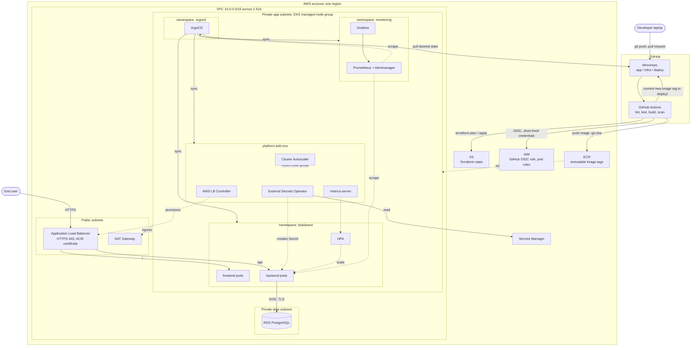
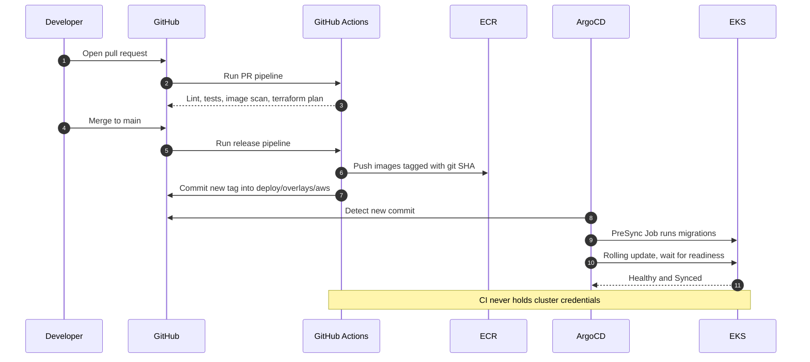

# GPJ2617 — Architecture Design

**Design and Implementation of a Secure, Auto-Scaling Multi-Service Infrastructure Using GitOps and Kubernetes**

Status: Draft v1 for review · Date: 2026-10-12 · Scope: design only, no implementation code

---

## 1. Summary

The project's deliverable is the **platform**, not the application. The application exists to give the platform something realistic to build, deploy, scale, break, and recover.

| Layer | Choice |
|---|---|
| Demo application | **TaskBoard**, a small task-management app (React + FastAPI + PostgreSQL) |
| Cloud | AWS, one region, two Availability Zones |
| Infrastructure as Code | Terraform (remote state in S3) |
| Orchestration | Amazon EKS with a managed node group |
| Database | Amazon RDS for PostgreSQL in private subnets |
| CI | GitHub Actions (lint, test, build, scan, push) |
| CD | ArgoCD, pull-based GitOps |
| Scaling | HPA for pods, Cluster Autoscaler for nodes |
| Observability | Prometheus, Alertmanager, Grafana (kube-prometheus-stack) |
| Local environments | Docker Compose (inner loop) and a `kind` cluster (platform rehearsal) |

**Why a task-management app:** it is the smallest application that still exercises every platform concern: a stateless API that can scale horizontally, a database behind a network boundary, schema migrations on each rollout, and health endpoints for probes. Keeping it to one table leaves the project time for the infrastructure. Request validation and JSON serialisation in the API are CPU-bound, so load from k6 drives the CPU-based HPA without artificial endpoints. The trade-off is that the app has no natural traffic-spike story and no login, so the load profile is synthetic.

---

## 2. Application Components

| Component | Runtime | Responsibilities | Port | Scales |
|---|---|---|---|---|
| **frontend** | React (Vite) static build served by unprivileged NGINX | List, filter, create, edit, and delete tasks | 8080 | 2 to 4 replicas |
| **backend** | FastAPI on Uvicorn, SQLAlchemy, Alembic | REST API under `/api` with task CRUD and health endpoints; `/metrics` is added in M6 | 8000 | 2 to 10 replicas |
| **database** | PostgreSQL 16 (RDS on AWS, container locally) | `tasks` | 5432 | Vertical only |
| **migrations** | Same backend image, different command | Runs Alembic as an ArgoCD PreSync Job before each rollout | n/a | One-shot |

Backend contract with the platform:

- `GET /api/healthz` for liveness (process is up).
- `GET /api/readyz` for readiness (database reachable).
- `GET /metrics` for Prometheus, added in M6. It sits outside `/api`, so the load balancer never routes to it.
- No authentication in this version. The API is open to anyone who can reach it, which is acceptable for a demo workload and is recorded as a limitation.
- Stateless: no local sessions or files, so any replica can serve any request.
- Configuration only through environment variables; secrets injected at runtime.
- Database pool capped at 5 connections per pod. With 10 pods that is 50 connections, safely under the limit of a micro RDS instance.

---

## 3. Architecture Diagram



### Delivery flow



---

## 4. Networking

| Subnet tier | CIDRs (AZ a, AZ b) | Contains | Internet |
|---|---|---|---|
| Public | `10.0.0.0/24`, `10.0.1.0/24` | ALB, NAT Gateway | Inbound 443 to the ALB only |
| Private app | `10.0.16.0/20`, `10.0.32.0/20` | EKS worker nodes and pods | Outbound only, through NAT |
| Private data | `10.0.8.0/24`, `10.0.9.0/24` | RDS | None |

- The app subnets are large because the VPC CNI gives every pod a real VPC address.
- **Prefix delegation is enabled on the VPC CNI.** Without it a `t3.medium` holds only 17 pods, and the platform add-ons alone would fill two nodes.
- One NAT Gateway instead of one per AZ. This is a deliberate cost saving and a known single point of failure for outbound traffic (see ADR-010).
- Ingress routing on a single hostname: `/` goes to frontend, `/api` goes to backend. Same origin, so no CORS configuration is needed.
- ALB targets pods directly (IP target mode), skipping the NodePort hop.
- ArgoCD and Grafana are **not** exposed publicly. They are reached with `kubectl port-forward`.

---

## 5. Security Boundaries

| # | Boundary | Control |
|---|---|---|
| 1 | Internet to VPC | Only the ALB is public. TLS terminates at the ALB with an ACM certificate. HTTP redirects to HTTPS. |
| 2 | ALB to pods | ALB security group is the only allowed source for pod ports 8080 and 8000. |
| 3 | Pods to database | RDS security group accepts 5432 only from the node security group. RDS is not publicly accessible, storage is encrypted, TLS is required. |
| 4 | Pod to pod | Default-deny NetworkPolicy per namespace. Allowed: ALB to frontend, ALB to backend, backend to RDS, Prometheus to `/metrics`, DNS. The frontend cannot reach the database. |
| 5 | Pod to node | Pod Security Standard `restricted` on the app namespace: non-root, read-only root filesystem, no privilege escalation, all capabilities dropped, requests and limits set. |
| 6 | Pod to AWS APIs | Each add-on has its own least-privilege IAM role (EKS Pod Identity). Application pods have no AWS permissions. |
| 7 | CI to AWS | GitHub OIDC federation. No long-lived AWS keys stored in GitHub. The role trusts only this repository. |
| 8 | CI to cluster | None. CI cannot reach the Kubernetes API. Only ArgoCD, running inside the cluster, applies changes. |
| 9 | Humans to cluster | EKS access entries mapped to IAM identities. The public API endpoint is restricted to known CIDRs. Root account has MFA and is not used day to day. |
| 10 | Secrets | Stored in AWS Secrets Manager, synced into the cluster by External Secrets Operator. Git contains only references, never values. |
| 11 | Supply chain | Images tagged by git SHA, ECR tags immutable, scan on push. Pipeline fails on fixable HIGH or CRITICAL findings. |

Scanning in CI: Trivy (images and Terraform/Kubernetes config), Gitleaks (committed secrets), `pip-audit` and `npm audit` (dependencies).

---

## 6. CI/CD Flow

**Pull request pipeline** (must pass before merge):

1. Path filter decides which jobs run (`app/frontend`, `app/backend`, `infra`, `deploy`).
2. Backend: lint, type check, unit tests against a PostgreSQL service container.
3. Frontend: lint, unit tests, production build.
4. Build both images without pushing, then scan with Trivy.
5. Gitleaks over the diff.
6. Infrastructure: `terraform fmt`, `validate`, config scan, and `plan` posted as a PR comment.
7. Manifests: render Kustomize overlays and validate them against the Kubernetes schema.

**Release pipeline** (on merge to `main`):

1. Assume the AWS role through OIDC.
2. Build images, tag with the short git SHA, scan, push to ECR.
3. Update the image tag in `deploy/overlays/aws` and commit it back with a bot identity.
4. Stop. Deployment from here belongs to ArgoCD.

**Infrastructure pipeline** (manual trigger with approval): `infra-up` and `infra-down` workflows run `terraform apply` and `terraform destroy` for the ephemeral stack, so creating and removing the environment needs no console clicks.

---

## 7. GitOps Flow

- **Ownership split:** Terraform owns everything in AWS and installs ArgoCD once. ArgoCD owns everything inside the cluster after that.
- **App of Apps:** Terraform creates one root ArgoCD Application pointing at `deploy/argocd`. That directory declares all other Applications.
- **Sync waves** order the rollout: (0) namespaces and CRDs, (1) platform add-ons, (2) monitoring, (3) application.
- **Sync policy:** automated, with `prune` and `selfHeal` on. Manual changes with `kubectl` are reverted.
- **Rollback** is `git revert` of the tag-bump commit. No special tooling.
- **Migrations** run as a PreSync hook Job. If the Job fails, the rollout does not start.
- Third-party charts are pinned to exact versions in Git.

---

## 8. Monitoring

| Signal | Source | Used for |
|---|---|---|
| Request rate, error rate, latency (p50/p95/p99) | Backend `/metrics` via ServiceMonitor | Service health, load test evidence |
| Pod CPU and memory, restarts, replica counts | kube-state-metrics, cAdvisor | HPA behaviour, capacity |
| Node CPU, memory, disk | node-exporter | Node scaling evidence |
| External availability | Blackbox exporter probing the public URL | Uptime percentage |
| Sync and health status | ArgoCD metrics | Deployment tracking, drift events |

**Dashboards:** (1) Service overview, (2) Auto-scaling: replicas against load, (3) Cluster resources, (4) Delivery: sync status and deployment timeline.

**Alerts:** error rate above 5% for 2 minutes, p95 above 1 second for 5 minutes, pod crash-looping, HPA pinned at max for 10 minutes, ArgoCD app OutOfSync or Degraded for 10 minutes, public probe failing for 1 minute.

Prometheus keeps 7 days on a gp3 volume. Centralised logs (Loki) are a stretch goal; `kubectl logs` is the baseline.

---

## 9. Scaling and Availability Strategy

| Level | Mechanism | Setting |
|---|---|---|
| Pods (backend) | HPA on CPU | Target 60%, min 2, max 10, scale-down stabilisation 5 minutes |
| Pods (frontend) | HPA on CPU | Target 70%, min 2, max 4 |
| Nodes | Cluster Autoscaler on the managed node group | `t3.medium`, min 2, max 4 |
| Spread | Topology spread constraints | Replicas distributed across both AZs |
| Disruption | PodDisruptionBudget | At least 1 pod available per service during node drains |
| Rollouts | Rolling update | `maxUnavailable: 0`, readiness gates traffic |
| Database | RDS | Single-AZ by default; Multi-AZ is a Terraform variable switched on for the failover demo |

Load is generated with **k6** from a laptop, using three scenarios: steady baseline, ramp to peak, and a sudden spike. Each scenario mixes reads and writes.

Stretch goal: scale on requests per second through Prometheus Adapter or KEDA, and compare it with CPU-based scaling.

---

## 10. What Runs Where

| Activity | Local laptop | AWS |
|---|---|---|
| Writing application code with hot reload | Docker Compose: frontend, backend, PostgreSQL | |
| Unit tests | Yes | Also in GitHub Actions |
| Rehearsing manifests, ArgoCD, HPA, Prometheus | `kind` cluster | |
| Container registry | Images loaded directly into `kind` | ECR |
| Database | PostgreSQL container | RDS |
| Ingress | Port-forward or a local ingress | ALB with ACM |
| Secrets | Plain Kubernetes Secret with dummy values | Secrets Manager + External Secrets |
| Node scaling, multi-AZ, security groups, IAM | Not reproducible locally | Yes |
| Final measurements and the demo | | Yes |
| Running `terraform`, `kubectl`, `k6` | Yes, as clients | They act on AWS |

**Principle:** everything that can be proven locally is proven locally first. AWS time is spent only on what needs AWS.

### Cost model

AWS resources are split into two Terraform stacks:

- **Persistent** (pennies per month, never destroyed): state bucket, ECR repositories, GitHub OIDC role, budget alarm, optional DNS zone.
- **Ephemeral** (created per work session, destroyed afterwards): VPC, NAT, EKS, node group, RDS, ALB.

Approximate on-demand rates for the ephemeral stack in `us-east-1`. Verify against the AWS pricing calculator before committing to a budget:

| Resource | Approx. per hour |
|---|---|
| EKS control plane | $0.10 |
| 2 x `t3.medium` nodes | $0.08 |
| NAT Gateway | $0.045 |
| ALB | $0.025 |
| RDS `db.t4g.micro` | $0.02 |
| **Total** | **about $0.27** |

Left running all month that is roughly $195. Used for 60 hours a month it is roughly $16. An AWS Budgets alarm is created in Milestone 0.

---

## 11. Repository Structure

```
taskboard-platform/
├── app/
│   ├── frontend/              React source, Dockerfile, NGINX config
│   └── backend/               FastAPI source, Alembic migrations, tests, Dockerfile
├── infra/
│   ├── modules/
│   │   ├── network/           VPC, subnets, NAT, route tables
│   │   ├── eks/               Cluster, node group, add-ons, access entries
│   │   ├── rds/               Instance, subnet group, security group
│   │   ├── ecr/               Repositories and lifecycle rules
│   │   └── iam/               GitHub OIDC role, pod identity roles
│   └── stacks/
│       ├── persistent/        State bucket, ECR, OIDC, budget
│       ├── platform/          VPC, EKS, RDS (ephemeral)
│       └── bootstrap/         ArgoCD install and root Application
├── deploy/
│   ├── argocd/                Root app and child Application definitions
│   ├── platform/              Pinned values for LB controller, ESO, autoscaler, metrics-server
│   ├── monitoring/            kube-prometheus-stack values, dashboards, alert rules
│   └── apps/taskboard/
│       ├── base/              Deployments, Services, HPA, PDB, NetworkPolicy
│       └── overlays/
│           ├── local/         kind: local images, in-cluster PostgreSQL
│           └── aws/           ECR images, Ingress, ExternalSecret
├── .github/workflows/         pr.yml, release.yml, infra-up.yml, infra-down.yml
├── loadtest/                  k6 scenarios
├── docs/
│   ├── architecture.md        This document
│   ├── adr/                   One file per decision
│   ├── runbooks/              Bring-up, tear-down, rollback, incident drills
│   └── evaluation/            Raw results, screenshots, graphs for the thesis
├── docker/postgres/init/      Local-only database init scripts
├── docker-compose.yml
├── .env.example
└── README.md                  Setup, test, and verification commands
```

`bootstrap` is a separate stack from `platform` because the Helm and Kubernetes providers need a cluster that already exists.

---

## 12. Implementation Milestones

Durations assume two people working part-time. Adjust once the submission date is fixed.

| # | Milestone | Deliverables | Exit criterion | Est. |
|---|---|---|---|---|
| M0 | Foundations | Repository, branch protection, ADRs committed, AWS account with MFA and budget alarm, local toolchain | Both members can clone, and the budget alarm is confirmed by email | 1 wk |
| M1 | Application | Frontend, backend, schema, migrations, tests, Docker Compose | Task CRUD works end to end on `localhost`; backend and frontend tests pass | 2 wks |
| M2 | Containers and CI | Hardened Dockerfiles, PR pipeline, security scans | A PR with a failing test or a critical vulnerability is blocked | 1 wk |
| M3 | Local Kubernetes and GitOps | Kustomize base and `local` overlay, ArgoCD on `kind`, app of apps | Changing a manifest in Git changes the `kind` cluster with no `kubectl apply` | 2 wks |
| M4 | AWS infrastructure | Persistent and platform stacks, `infra-up` / `infra-down` workflows | Empty account to a Ready cluster and reachable RDS in one run; destroy leaves nothing behind | 2 wks |
| M5 | GitOps on EKS | Bootstrap stack, `aws` overlay, ALB, TLS, External Secrets, release pipeline | A merged commit is serving on the public URL with no human action | 2 wks |
| M6 | Observability | Prometheus stack, dashboards, alerts, blackbox probe | All four dashboards show live data; a forced failure fires an alert | 1 wk |
| M7 | Scaling and resilience | HPA, Cluster Autoscaler, PDBs, k6 scenarios, failure drills | Scaling and recovery criteria in section 14 are met and recorded | 2 wks |
| M8 | Hardening and evaluation | NetworkPolicies, Pod Security, final measurements, manual-deployment baseline, thesis material | Every acceptance criterion has recorded evidence in `docs/evaluation` | 2 wks |

Total: about 15 weeks. M1 through M3 cost nothing on AWS.

---

## 13. Architecture Decision Records

**ADR-001: Demo application is a small task-management system** (revised 2026-10-12; the first draft proposed a ticket booking app)
- Context: The platform needs a workload that is small enough to finish quickly and still exercises scaling, migrations, and a database boundary.
- Decision: TaskBoard with one table, CRUD endpoints, and two health endpoints. No authentication.
- Alternatives: Ticket booking (better traffic-spike story, about three times the application work), e-commerce (too much application work).
- Consequence: Minimal application effort. The load profile is synthetic and the API is unauthenticated, both stated as limitations. Application scope is frozen after M1; new features are refused unless the platform evaluation needs them.

**ADR-002: Amazon EKS as the Kubernetes platform**
- Context: The project title commits to AWS and Kubernetes.
- Decision: EKS with a managed node group.
- Alternatives: k3s on EC2 (much cheaper, but self-managed control plane and weaker AWS integration), ECS (not Kubernetes), EKS Auto Mode (hides the scaling mechanics we want to demonstrate).
- Consequence: Fixed control plane cost of about $0.10 per hour, handled by ADR-010.

**ADR-003: RDS for PostgreSQL instead of a database in the cluster**
- Context: Stateful workloads complicate scaling, recovery, and tear-down.
- Decision: RDS on AWS, a plain container locally.
- Alternatives: StatefulSet or CloudNativePG operator.
- Consequence: Clean stateless cluster and a clear network boundary to show. The local and AWS environments differ at the database, which the overlays isolate.

**ADR-004: Single monorepo**
- Context: GitOps practice often separates application and configuration repositories.
- Decision: One repository with strict top-level boundaries (`app`, `infra`, `deploy`) and path-filtered workflows.
- Alternatives: Separate GitOps repository.
- Consequence: Simpler to develop, review, and examine. Application and deployment history are mixed, and the CI bot needs permission to push tag bumps to `main`. Splitting later is a mechanical change.

**ADR-005: Pull-based GitOps with ArgoCD**
- Context: Deployments must be automatic, auditable, and resistant to drift.
- Decision: ArgoCD with automated sync, prune, and self-heal. CI only writes to Git.
- Alternatives: `kubectl apply` or `helm upgrade` from CI (push model), Flux.
- Consequence: CI never holds cluster credentials. Git history is the deployment log. ArgoCD has a UI that helps in the demo.

**ADR-006: Kustomize for our app, Helm for third-party software**
- Context: Two environments share most of their configuration.
- Decision: Kustomize base and overlays for TaskBoard; upstream Helm charts with pinned versions for add-ons.
- Alternatives: Our own Helm chart for the app.
- Consequence: Plain readable YAML and a trivial image tag bump. Less flexibility than templating, which we do not need.

**ADR-007: Secrets Manager with External Secrets Operator**
- Context: Git must not contain secret values, yet Git must describe the full desired state.
- Decision: Values live in Secrets Manager; `ExternalSecret` resources in Git reference them. RDS manages its own master password there.
- Alternatives: Sealed Secrets (encrypted values in Git, no rotation), Secrets Store CSI driver.
- Consequence: One extra operator. Rotation works without a commit.

**ADR-008: GitHub OIDC instead of stored AWS access keys**
- Context: Long-lived cloud keys in CI are a common breach path.
- Decision: GitHub Actions assumes an IAM role through OIDC, scoped to this repository.
- Alternatives: IAM user keys in GitHub Secrets.
- Consequence: Nothing to leak or rotate. A measurable security claim for the thesis.

**ADR-009: AWS Load Balancer Controller with an ALB**
- Context: The cluster needs a public HTTPS entry point.
- Decision: Ingress resources reconciled into an ALB, TLS from ACM.
- Alternatives: ingress-nginx behind an NLB (the project has been retired upstream), Gateway API (stretch goal).
- Consequence: Native AWS integration and free certificates. The local cluster uses a different ingress path. Ingresses must be deleted before `terraform destroy`, or the orphaned ALB blocks VPC deletion; the `infra-down` workflow handles this order.

**ADR-010: Ephemeral AWS environment, local-first development**
- Context: A student budget cannot run EKS, NAT, and RDS continuously.
- Decision: Split persistent and ephemeral stacks. Create the environment per session and destroy it after. Use a single NAT Gateway and Single-AZ RDS by default.
- Alternatives: Always-on environment, NAT instance, public-subnet nodes.
- Consequence: Roughly a tenfold cost reduction, and repeated rebuilds prove the IaC works. Each session starts with a 20 minute wait. Outbound traffic has a single point of failure, documented as a known limitation.

**ADR-011: CPU-based HPA plus Cluster Autoscaler**
- Context: Scaling must be demonstrable at both pod and node level.
- Decision: HPA on CPU utilisation through metrics-server; Cluster Autoscaler for nodes.
- Alternatives: Custom metrics through Prometheus Adapter or KEDA, Karpenter.
- Consequence: Minimal moving parts and behaviour that is easy to explain. CPU is an indirect signal for an I/O-bound API; request-rate scaling is kept as a stretch comparison.

**ADR-012: Self-hosted Prometheus and Grafana**
- Context: The abstract names Prometheus and Grafana.
- Decision: kube-prometheus-stack inside the cluster, deployed by ArgoCD.
- Alternatives: Amazon Managed Prometheus and Managed Grafana, CloudWatch Container Insights.
- Consequence: No per-metric charges and the same stack runs on `kind`. Monitoring data is lost on tear-down, so evaluation evidence is exported before each destroy.

---

## 14. Measurable Acceptance Criteria

Targets are initial proposals. They are confirmed or revised after the first baseline run in M7.

### Infrastructure as Code
| ID | Criterion | Target | Measured by |
|---|---|---|---|
| A1 | Environment built from an empty account state | One workflow run, 25 minutes or less, zero console actions | Workflow duration |
| A2 | No drift after apply | `terraform plan` reports zero changes | Plan output |
| A3 | Clean tear-down | Zero billable resources tagged with the project remain | AWS resource tag query |

### Continuous Integration
| ID | Criterion | Target | Measured by |
|---|---|---|---|
| B1 | PR pipeline duration | 10 minutes or less | Workflow duration, median of 10 runs |
| B2 | Broken code cannot merge | PR with a failing test is blocked | Demonstration PR |
| B3 | Vulnerable image cannot ship | Image with a fixable CRITICAL finding fails the pipeline | Demonstration PR with an old base image |
| B4 | No static cloud credentials | Zero AWS access keys in GitHub secrets | Repository settings, IAM credential report |

### Continuous Delivery and GitOps
| ID | Criterion | Target | Measured by |
|---|---|---|---|
| C1 | Merge-to-production lead time | 10 minutes or less, median of 10 deployments | Merge timestamp to ArgoCD Healthy timestamp |
| C2 | Improvement over manual deployment | At least 70% shorter than a timed manual baseline | Same change deployed by hand, timed once |
| C3 | Manual steps per deployment | Zero | Runbook comparison |
| C4 | Drift correction | Manual `kubectl` change reverted within 3 minutes | Timed drill |
| C5 | Rollback | `git revert` restores the previous version within 10 minutes | Timed drill |
| C6 | Zero-downtime rollout | Under 0.1% failed requests while deploying under load | k6 running during a release |

### Scaling
| ID | Criterion | Target | Measured by |
|---|---|---|---|
| D1 | Pod scale-out | Backend grows from 2 to at least 6 replicas within 3 minutes of the ramp | Grafana, HPA events |
| D2 | Service quality under peak | p95 latency under 500 ms, error rate under 1% | k6 summary |
| D3 | Node scale-out | A new node joins and takes pods within 5 minutes of pods going Pending | Cluster Autoscaler logs |
| D4 | Scale-in | Back to minimum replicas within 10 minutes after load stops | Grafana |
| D5 | Correctness under load | Zero lost writes: every task k6 created successfully exists in the database | Row count compared with the k6 success count |

### Resilience
| ID | Criterion | Target | Measured by |
|---|---|---|---|
| E1 | Pod failure | Replacement Ready within 60 seconds, under 1% failed requests | Delete a pod during load |
| E2 | Node failure | Service stays available, full capacity back within 5 minutes | Terminate an EC2 instance during load |
| E3 | Availability during test window | 99.9% or better over a 2-hour soak that includes E1 and E2 | Blackbox probe success ratio |

### Security
| ID | Criterion | Target | Measured by |
|---|---|---|---|
| F1 | No secrets in Git | Zero Gitleaks findings across full history | Gitleaks report |
| F2 | Database isolation | RDS unreachable from the internet and from the frontend pod | Connection attempts from both |
| F3 | Namespace isolation | A pod in another namespace cannot reach the backend | Connection attempt |
| F4 | Pod hardening | 100% of app pods run non-root with a read-only root filesystem | Pod Security admission, config scan |
| F5 | Encrypted transport | HTTP redirects to HTTPS; TLS 1.2 or higher only | External TLS check |

### Observability
| ID | Criterion | Target | Measured by |
|---|---|---|---|
| G1 | Dashboards | Four dashboards, defined in Git, showing live data | Screenshots |
| G2 | Alerting | Induced failure raises an alert within 2 minutes | Timed drill |
| G3 | Scaling is visible | One graph shows request rate, replica count, and latency on a shared timeline | Screenshot for the thesis |

---

## 15. Risks and Known Limitations

| Risk | Mitigation |
|---|---|
| AWS bill exceeds budget because an environment is left running | Budget alarm, `infra-down` workflow, a tear-down check at the end of every session |
| Orphaned ALB or security groups block `terraform destroy` | Tear-down removes ArgoCD applications first, then infrastructure |
| Application work consumes platform time | Scope frozen by ADR-001 |
| Two nodes too small for add-ons plus scaled app | Prefix delegation on; node group can grow to 4; instance type is a variable |
| No custom domain available | Fall back to the ALB hostname over HTTP and record F5 as not met, or buy a low-cost domain |
| Single NAT Gateway and Single-AZ RDS | Stated limitation; both are Terraform variables for a production configuration |

---

## 16. Decisions Needed From the Team

1. **Submission date and team size**, to fix the milestone calendar.
2. **AWS budget or credits available**, to confirm the ephemeral model is enough.
3. **Custom domain**: buy one (needed for real HTTPS) or accept the fallback.
4. **Region**: `us-east-1` is assumed for price; change it if the supervisor prefers another.
