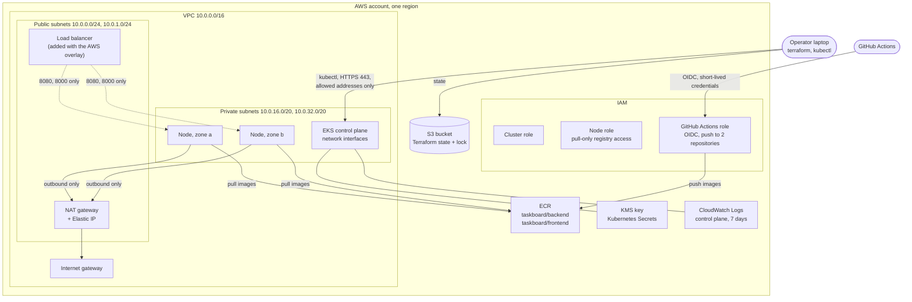

# AWS Infrastructure with Terraform

Terraform code for the AWS side of the project: network, IAM, image registry, and the EKS cluster. This document covers the design, what it costs, and how to validate, deploy, and destroy it.

> **Applied and verified on 13 October 2026** in `eu-north-1`, on an AWS free plan account. The cluster came up with two nodes, `terraform plan` afterwards reported no changes, and the application was deployed to it (see [gitops-aws.md](gitops-aws.md)). `terraform apply` creates billable resources: read the cost section first.

Commands are for Windows PowerShell, run from the repository root.

## 1. Architecture



### What is created

| Stack | Resources | Lifetime |
|---|---|---|
| `state-backend` | S3 bucket for Terraform state: versioned, encrypted, private, TLS only | Once per account, kept |
| `persistent` | 2 ECR repositories with scanning and lifecycle rules. GitHub OIDC provider and a push-only role (standard accounts only) | Kept between sessions |
| `platform` | VPC, 2 public and 2 private subnets, internet gateway, NAT gateway with Elastic IP, route tables, security groups, IAM roles, KMS key, log group, EKS cluster, managed node group, 6 add-ons (VPC CNI, kube-proxy, CoreDNS, Pod Identity agent, EBS CSI driver, metrics-server), and 2 IAM roles bound to service accounts | Created per work session, destroyed after |

### Network

| Subnet tier | Ranges | Contains | Route to the internet |
|---|---|---|---|
| Public | `10.0.0.0/24`, `10.0.1.0/24` | NAT gateway, load balancer | Direct, through the internet gateway |
| Private | `10.0.16.0/20`, `10.0.32.0/20` | Worker nodes, pods, control plane interfaces | Outbound only, through the NAT gateway |

- Nodes have no public addresses and cannot be reached from the internet.
- Private ranges are large because the VPC CNI gives every pod a VPC address. Prefix delegation is on, which raises the pod limit of a `t3.medium` from 17 to 110.
- One NAT gateway serves both zones. It is cheaper, and outbound traffic stops if that zone fails. `single_nat_gateway = false` creates one per zone.

### Security groups

| Group | Inbound | Outbound |
|---|---|---|
| Load balancer | 80 and 443 from the internet | 8080 and 8000, to the cluster group only |
| Cluster (created by EKS) | Its own members, plus 8080 and 8000 from the load balancer group | Managed by EKS |
| VPC default | Nothing | Nothing. Emptied on purpose. |

### IAM, least privilege

| Role | Who can assume it | What it can do |
|---|---|---|
| Cluster | The EKS service only | `AmazonEKSClusterPolicy` |
| Node | EC2 instances only | Join the cluster, configure pod networking, **pull** images. No push, no delete. |
| GitHub Actions | Workflows of this repository on `main` only, through OIDC | Log in to ECR and push to the two project repositories. Nothing else in the account. |
| EBS CSI driver | Only the service account `kube-system/ebs-csi-controller-sa` in this cluster | Create, attach, and delete EBS volumes (`AmazonEBSCSIDriverPolicy`) |
| Load balancer controller | Only the service account `kube-system/aws-load-balancer-controller` in this cluster | Manage load balancers, using the policy published with the controller release |

The last two use EKS Pod Identity. A controller that calls AWS would otherwise have to borrow the node's role, and then every pod on the node could use those permissions too.

No IAM user and no long-lived access key is created anywhere.

Cluster access uses EKS access entries. The identity that runs Terraform becomes administrator. Others are added through `admin_principal_arns`.

### Other security settings

- Kubernetes Secrets are encrypted with a KMS key owned by the account, with yearly rotation.
- The Kubernetes API has a private endpoint, and a public one limited to the addresses in `cluster_endpoint_public_access_cidrs`. That variable has no default: it must be set.
- API, audit, and authenticator logs go to CloudWatch and expire after 7 days.
- ECR tags are immutable and every pushed image is scanned.
- State is encrypted, versioned, never public, and locked during changes.

### Not in this step

| Item | Why | Arrives with |
|---|---|---|
| RDS database | Not requested for this step, and it adds cost | A later step. Until then the AWS overlay can run PostgreSQL in the cluster. |
| Load balancer, TLS certificate | Created by the load balancer controller from an Ingress | GitOps on EKS |
| ArgoCD, cluster autoscaler, monitoring | Run inside the cluster | Following milestones |

## 2. Code layout

```
infra/
├── backend.hcl.example          Where state is stored (copy to backend.hcl)
├── modules/                     Reusable, no state of their own
│   ├── network/                 VPC, subnets, gateways, routes
│   ├── iam/                     Cluster and node roles, or reuse existing ones
│   ├── github-oidc/             Keyless access for GitHub Actions
│   ├── ecr/                     Image repositories
│   ├── eks/                     Cluster, add-ons, node group, KMS key, logs
│   └── security/                Load balancer security group and rules
└── stacks/                      Deployable units, each with its own state
    ├── state-backend/           The state bucket (local state)
    ├── persistent/              ECR and the GitHub role
    └── platform/                Network and cluster
```

| Practice | How |
|---|---|
| Reusable modules | Six modules with typed, documented, validated inputs and documented outputs |
| Version constraints | Terraform `>= 1.10, < 2.0`. AWS provider `~> 6.0` in stacks, `>= 6.0` in modules. Exact versions pinned in each stack's committed `.terraform.lock.hcl`. |
| Remote state | S3, one key per stack |
| Locking | S3 lock file (`use_lockfile = true`). No DynamoDB table is needed. |
| Tests | 25 mocked plan tests (`terraform test`) covering both account types, defaults, and input validation |
| Scanning | Trivy configuration scan in CI, failing on HIGH and CRITICAL findings |

Three deliberate exceptions to the scanner are marked in the code with their reasons: the public load balancer accepts internet traffic, the Kubernetes API has a restricted public endpoint, and the state bucket uses S3-managed rather than customer-managed encryption.

## 3. AWS prerequisites

### Standard AWS account

| Requirement | Detail |
|---|---|
| Account security | MFA on the root user. Do not use root for daily work. |
| Identity for Terraform | An IAM Identity Center user or role with administrator access for the first apply. Sign in with `aws configure sso`. |
| Budget alert | An AWS Budgets alert at a small amount, created before anything else |
| Region | `us-east-1` assumed |
| Quotas | Defaults are enough: 1 VPC, 1 NAT gateway, 1 Elastic IP, 2 `t3.medium` (4 vCPU) |

### AWS free plan account (the one this project uses)

New AWS accounts on the free plan come with credits and a set of restrictions. These were found by trying, on the account used here, and each one cost time:

| Restriction | How it showed up | What to set |
|---|---|---|
| One region only (`eu-north-1` here) | Every call in any other region is refused by a service control policy, including read-only ones | `region = "eu-north-1"` in both variable files and in `backend.hcl` |
| Only some instance types | The node group stayed in `CREATING` with no instances. The Auto Scaling activity log said "The specified instance type is not eligible for Free Tier". | `node_instance_types = ["m7i-flex.large"]`. List the allowed types with `aws ec2 describe-instance-types --filters Name=free-tier-eligible,Values=true` |
| 5 vCPUs in total | Quota lookup | `node_max_size = 2` |
| No OIDC identity providers | Refused by the service control policy | `enable_github_oidc = false`. Pod Identity is used inside the cluster instead of IAM Roles for Service Accounts. |
| No charges to a card | By design of the plan | Spending comes out of the credits. The account stops when they run out. |

IAM roles, KMS keys, EKS, ECR, NAT gateways, and load balancers are all allowed.

A lesson from the instance type failure: a node group that cannot launch instances does not fail quickly. EKS waited about 30 minutes before letting the failed group be deleted. Check `aws autoscaling describe-scaling-activities` as soon as nodes are late.

### AWS Academy Learner Lab

The code supports the lab, with reduced scope. Set `enable_pod_identity_roles = false` there as well. These points come from the lab's general rules and **must be checked against the README inside your own lab**, because they vary by course.

| Lab rule | Effect on this project |
|---|---|
| IAM roles, policies, and identity providers cannot be created | Set `existing_cluster_role_arn` and `existing_node_role_arn` to the lab's `LabRole`, and `enable_github_oidc = false`. Terraform then creates no IAM resources. |
| `LabRole` is broad, not least privilege | The least-privilege roles exist in code and are tested, but cannot be demonstrated live in the lab. State this as a limitation. |
| No OIDC role for GitHub | CI cannot push to ECR without stored keys. Images are pushed from the laptop instead. |
| Credentials are temporary | Copy them from "AWS Details" at the start of every session. They stop working when the session ends. |
| Fixed budget, often 50 or 100 USD | Shown at the top of the lab page as used and total. **If it reaches zero the account is closed and everything in it is lost.** |
| Sessions end after a few hours | EC2 instances are stopped, but the EKS control plane and the NAT gateway keep running and keep spending budget. **Destroy the platform stack at the end of every session.** |
| Regions limited | Usually `us-east-1` and `us-west-2` |
| KMS may be restricted | If key creation is denied, set `enable_secrets_encryption = false` |

### Tools

| Tool | Version | Check |
|---|---|---|
| Terraform | 1.10 or newer (developed with 1.16.5) | `terraform version` |
| AWS CLI | v2 | `aws --version` |
| kubectl | Within one minor version of the cluster | `kubectl version --client` |

## 4. Cost estimate

Prices are approximate on-demand rates for `us-east-1` and change over time. Confirm with the [AWS Pricing Calculator](https://calculator.aws) before approving an apply.

### Platform stack, while it exists

| Resource | Rate | Per hour | Per month (730 h) |
|---|---|---|---|
| EKS control plane | 0.10 USD/h | 0.1000 | 73.00 |
| 2 x `t3.medium` nodes | 0.0416 USD/h each | 0.0832 | 60.74 |
| NAT gateway | 0.045 USD/h | 0.0450 | 32.85 |
| Elastic IP for the NAT gateway | 0.005 USD/h | 0.0050 | 3.65 |
| 2 x 20 GB gp3 node disks | 0.08 USD/GB-month | 0.0044 | 3.20 |
| KMS key | 1 USD/month | 0.0014 | 1.00 |
| NAT data processing | 0.045 USD/GB, about 20 GB | usage | 0.90 |
| CloudWatch log ingestion | 0.50 USD/GB, about 1 GB | usage | 0.50 |
| **Total** | | **about 0.24** | **about 176** |

### As deployed on the free plan account

The free plan does not allow `t3.medium`, so the nodes are `m7i-flex.large` (2 vCPUs, 8 GB), and the region is Stockholm. Approximate list prices:

| Resource | Per hour |
|---|---|
| EKS control plane | 0.10 |
| 2 x `m7i-flex.large` nodes | about 0.20 |
| NAT gateway and its Elastic IP | about 0.05 |
| Application Load Balancer and its two public addresses, once the application is deployed | about 0.04 |
| Disks, KMS key, logs | about 0.01 |
| **Total** | **about 0.40** |

A 100 USD credit therefore covers about 250 hours with the application deployed.

### Always-on resources

| Resource | Per month |
|---|---|
| ECR storage, about 1 GB at 0.10 USD/GB | 0.10 |
| S3 state bucket, a few kilobytes | under 0.01 |
| GitHub OIDC provider, IAM roles | 0.00 |
| **Total** | **about 0.10** |

### What you would actually pay

| Usage pattern | Estimate |
|---|---|
| One 4-hour session | about 1 USD |
| 40 hours a month, destroyed between sessions | about 10 USD |
| Left running for a week | about 40 USD |
| Left running for a month | about 176 USD |

With a 50 USD lab budget, the platform can exist for about 200 hours in total, across the whole project.

### Costs that come later

| Resource | Per month if left on |
|---|---|
| Application Load Balancer, plus 2 public IPv4 addresses | about 24, plus traffic |
| RDS `db.t4g.micro`, 20 GB | about 15 |
| Extra nodes when the autoscaler scales out | 30 per `t3.medium` |
| Second NAT gateway (`single_nat_gateway = false`) | about 37 |

## 5. Potentially billable resources

Everything Terraform creates that can appear on a bill, and what could be left behind.

| Resource | Billed when | Removed by |
|---|---|---|
| EKS cluster | Every hour it exists | `platform` destroy |
| EC2 instances (nodes) | Every hour they run | `platform` destroy |
| EBS volumes of the nodes | While they exist | `platform` destroy |
| NAT gateway | Every hour, plus per GB | `platform` destroy |
| Elastic IP | Every hour | `platform` destroy |
| KMS key | Monthly, until deletion is scheduled | `platform` destroy. No charge during the 7-day deletion wait. |
| CloudWatch log group | Per GB ingested and stored | `platform` destroy |
| ECR images | Per GB stored | `persistent` destroy |
| S3 state bucket | Per GB stored, negligible | `state-backend` destroy |

**Resources Terraform does not know about.** Kubernetes creates AWS resources of its own. `terraform destroy` will not remove them, they keep costing money, and some block the VPC from being deleted:

| Created by | AWS resource | Remove before destroying |
|---|---|---|
| An Ingress or a Service of type LoadBalancer | Load balancer, target groups, security groups | Delete the Ingress or Service and wait until the load balancer is gone |
| A PersistentVolumeClaim | EBS volume | Delete the claim |

Section 9 includes a check for leftovers.

## 6. Validate without AWS

None of these commands contact AWS or need credentials.

```powershell
terraform fmt -check -recursive infra

foreach ($stack in 'state-backend', 'persistent', 'platform') {
    terraform "-chdir=infra/stacks/$stack" init -backend=false -input=false
    terraform "-chdir=infra/stacks/$stack" validate
}
```

Mocked plan tests:

```powershell
foreach ($dir in 'modules/iam', 'modules/network', 'modules/eks') {
    terraform "-chdir=infra/$dir" init -backend=false -input=false
    terraform "-chdir=infra/$dir" test
}
terraform -chdir=infra/stacks/platform test
```

Security scan:

```powershell
docker run --rm -v "${PWD}:/repo" aquasec/trivy:0.75.0 config --severity HIGH,CRITICAL --exit-code 1 --skip-dirs "**/.terraform" /repo/infra
```

CI runs all of the above on every pull request that touches `infra/`.

## 7. Deploy

> Steps 3 to 5 create billable resources. Read section 4 first.

### Step 1: sign in and confirm the account

Standard account:

```powershell
aws configure sso
aws sts get-caller-identity
```

Learner Lab: start the lab, open "AWS Details", and paste the credentials block into `C:\Users\<you>\.aws\credentials`. Then:

```powershell
aws sts get-caller-identity
aws iam get-role --role-name LabRole --query Role.Arn --output text
```

Check that the account ID is the one you expect before going further. Then see which Kubernetes versions the region offers:

```powershell
aws eks describe-cluster-versions --query "clusterVersions[].clusterVersion" --output text
```

### Step 2: prepare the variable files

```powershell
Copy-Item infra/stacks/persistent/terraform.tfvars.example infra/stacks/persistent/terraform.tfvars
Copy-Item infra/stacks/platform/terraform.tfvars.example infra/stacks/platform/terraform.tfvars
(Invoke-RestMethod https://checkip.amazonaws.com).Trim()
```

Edit both files. In the platform file, set `cluster_endpoint_public_access_cidrs` to the address printed by the last command, followed by `/32`. For the Learner Lab, use the commented lab lines. The `terraform.tfvars` files are git-ignored.

### Step 3: state bucket (once per account)

```powershell
terraform -chdir=infra/stacks/state-backend init
terraform -chdir=infra/stacks/state-backend plan -out=tfplan
terraform -chdir=infra/stacks/state-backend apply tfplan
terraform -chdir=infra/stacks/state-backend output -raw backend_config | Set-Content -Encoding ascii infra/backend.hcl
```

Creates 1 bucket and its 6 settings. Cost: negligible.

### Step 4: registry and CI role

```powershell
terraform -chdir=infra/stacks/persistent init "-backend-config=../../backend.hcl"
terraform -chdir=infra/stacks/persistent plan -out=tfplan
terraform -chdir=infra/stacks/persistent apply tfplan
```

Creates the 2 repositories and, on a standard account, the OIDC provider and role. Cost: negligible.

### Step 5: network and cluster

```powershell
terraform -chdir=infra/stacks/platform init "-backend-config=../../backend.hcl"
terraform -chdir=infra/stacks/platform plan -out=tfplan
```

**Read the plan.** It should list 49 resources to add on an account that allows IAM roles, 35 in the Learner Lab, and nothing to change or destroy. Then:

```powershell
terraform -chdir=infra/stacks/platform apply tfplan
```

Takes about 15 to 20 minutes, most of it the control plane and the node group. **Billing at about 0.24 USD per hour starts here.**

### Step 6: connect and verify

```powershell
aws eks update-kubeconfig --region us-east-1 --name taskboard-dev
kubectl get nodes -o wide
kubectl get pods -A
terraform -chdir=infra/stacks/platform plan -detailed-exitcode
```

Expected: 2 nodes `Ready` with private addresses only, system pods `Running`, and a plan reporting no changes (exit code 0), which shows there is no drift.

Switch `kubectl` back to the local cluster with `kubectl config use-context kind-taskboard`.

## 8. Day-to-day

| Task | Command |
|---|---|
| See what would change | `terraform -chdir=infra/stacks/platform plan` |
| Show outputs | `terraform -chdir=infra/stacks/platform output` |
| List managed resources | `terraform -chdir=infra/stacks/platform state list` |
| Your public address changed and `kubectl` times out | Update `cluster_endpoint_public_access_cidrs`, then plan and apply |
| A lock is stuck after an interrupted run | `terraform -chdir=infra/stacks/platform force-unlock <LOCK_ID>`, only when you are sure nobody else is running |

## 9. Destroy

### End of every work session

First remove what Kubernetes created in AWS (see section 5). While nothing is deployed to the cluster yet, there is nothing to remove.

```powershell
kubectl get ingress,service -A
kubectl get pvc -A
```

Delete any Ingress, any Service of type `LoadBalancer`, and any PersistentVolumeClaim, and wait for them to disappear. Then:

```powershell
terraform -chdir=infra/stacks/platform plan -destroy
terraform -chdir=infra/stacks/platform destroy
```

Takes about 10 to 15 minutes. The registry, its images, and the state bucket remain, at about 0.10 USD a month, so the next session only repeats step 5.

### Check that nothing is left

```powershell
aws eks list-clusters --query clusters
aws ec2 describe-nat-gateways --filter Name=state,Values=available,pending --query "NatGateways[].NatGatewayId"
aws ec2 describe-instances --filters Name=instance-state-name,Values=running,pending --query "Reservations[].Instances[].InstanceId"
aws ec2 describe-addresses --query "Addresses[].PublicIp"
aws elbv2 describe-load-balancers --query "LoadBalancers[].LoadBalancerName"
aws ec2 describe-volumes --filters Name=status,Values=available --query "Volumes[].VolumeId"
aws resourcegroupstaggingapi get-resources --tag-filters Key=Project,Values=taskboard --query "ResourceTagMappingList[].ResourceARN"
```

Each of the first six should print an empty list. The last one lists everything tagged for the project: after a session only the ECR repositories and the state bucket should remain. The KMS key also appears for 7 days while it waits for deletion, at no charge.

### Remove the project from the account completely

```powershell
terraform -chdir=infra/stacks/platform destroy

terraform -chdir=infra/stacks/persistent apply -var ecr_force_delete=true
terraform -chdir=infra/stacks/persistent destroy -var ecr_force_delete=true

terraform -chdir=infra/stacks/state-backend apply -var force_destroy=true
terraform -chdir=infra/stacks/state-backend destroy -var force_destroy=true
```

The repositories and the bucket refuse to be deleted while they hold images or state files. The `apply` before each `destroy` records the permission to delete them anyway. The state bucket goes last, because the other stacks need it in order to be destroyed.

### If a destroy fails

| Error | Cause | Fix |
|---|---|---|
| `DependencyViolation` on a subnet, the VPC, or the internet gateway | A load balancer or network interface created by Kubernetes still exists | Find it with the check commands above, delete it, run destroy again |
| `ExpiredToken` | Lab or SSO session ended | Sign in again, run destroy again. Terraform continues where it stopped. |
| `RepositoryNotEmptyException` | ECR repository still has images | Apply with `-var ecr_force_delete=true`, then destroy |
| `BucketNotEmpty` | State bucket still has versions | Apply with `-var force_destroy=true`, then destroy |
| Destroy interrupted halfway | Any reason | Run it again. It is safe to repeat. |

## 10. Known limitations

- One NAT gateway is a single point of failure for outbound traffic.
- The Kubernetes API is reachable from the internet, restricted by address and IAM. A production setup would use a VPN or a bastion and disable the public endpoint.
- VPC flow logs are off, to save cost. The scanner reports this at MEDIUM severity.
- Scheduler and controller-manager logs are off, to save cost.
- In the Learner Lab, IAM least privilege and keyless CI cannot be demonstrated live.
- Verified on one account type only, the AWS free plan. The standard-account path with the GitHub OIDC role, and the Learner Lab path with existing roles, are covered by plan tests but have not been applied.
